<picture>
  <source media="(prefers-color-scheme: dark)" srcset="assets/header-dark.svg">
  
</picture>

 

#### Selected work

- [**USSD Lab**](https://github.com/nchanjifaithful/UssdLab): automates multi-step USSD menus like mobile money, behind a clean custom interface.
- [**Number Cleaner**](https://github.com/nchanjifaithful/NumberCleaner): turns messy phone numbers into clean, copy-ready ones.
- [**ScamShield**](https://github.com/nchanjifaithful/ScamShield): detects scams in text, audio and images, with a focus on African contexts.

 

#### Tools

<picture>
  <source media="(prefers-color-scheme: dark)" srcset="https://skillicons.dev/icons?i=figma%2Cjava%2Candroidstudio%2Cdart%2Cflutter%2Cts%2Cjs%2Chtml%2Ccss%2Cpython%2Ctensorflow%2Cmatlab&theme=dark">
  
</picture>

Also Jupyter.

 

#### Elsewhere

[X / Twitter](https://x.com/nchanjifaithful)
